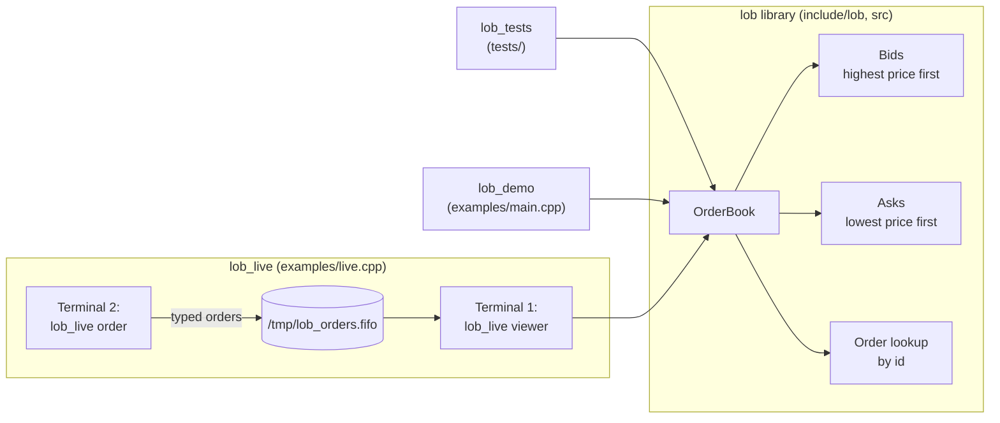

# Limit Order Book

This is a limit order book written in C++17. It's the part of an exchange that holds buy and sell orders for one instrument and matches them against each other. Orders are matched by price first, and if two orders have the same price, the one that came in first gets filled first.

You can place limit orders (GTC, IOC or FOK) and market orders, cancel orders, and change an order's price or size. A modified order goes to the back of the queue at its price, which is how most real exchanges handle it. You can also ask the book for the best bid and ask, or for the total size waiting at each price level. Prices are stored as whole numbers (ticks) rather than floats, so you don't get rounding problems when comparing them.

The code is split into the library (`include/lob/` and `src/`), the tests (`tests/`, which use a small built-in test helper so nothing else needs installing), and two example programs in `examples/`. One is a short demo that runs a few orders and prints the results. The other is a live view where you type orders in one terminal and watch the book update in another.

## How it fits together



Everything goes through the `OrderBook` class. It keeps the bids and asks as two sorted lists of price levels, and each level holds its orders in the order they arrived. It also keeps a lookup table from order id to where the order sits, so cancels and modifies don't have to search the whole book. When a new order comes in, it's matched against the other side for as long as the prices cross. Whatever is left either rests on the book or is thrown away, depending on the order type.

The tests and the demo use the library directly. The live example runs as two separate processes. The order entry side sends each line you type through a named pipe. The viewer owns the actual `OrderBook`, applies each order and redraws the screen.

## Building locally

You need CMake (3.16 or newer) and GCC. GCC is required because the code uses `<bits/stdc++.h>`, which the default Mac compiler doesn't have. On a Mac, install both once with:

```sh
brew install gcc cmake
```

CMake finds Homebrew's GCC on its own. Then, from the project folder:

```sh
cmake -S . -B build -DCMAKE_BUILD_TYPE=Release
cmake --build build -j
```

This puts the programs in the `build/` folder.

## Running

Run the tests:

```sh
ctest --test-dir build --output-on-failure
```

Run the demo:

```sh
./build/lob_demo
```

Run the live order book. It needs two terminals. In the first one, start the viewer, which shows the book and redraws it after every order:

```sh
./build/lob_live
```

In the second one, start the order entry and type orders:

```sh
./build/lob_live order
> buy 10 @ 100
> sell 4 @ 102
> sell 6 @ 99 ioc
> market buy 3
> cancel 1
> modify 2 8 @ 101
```

Order ids are given out automatically and show up in the activity log. You can add `ioc` or `fok` to the end of a limit order; without either, it's treated as `gtc`.
